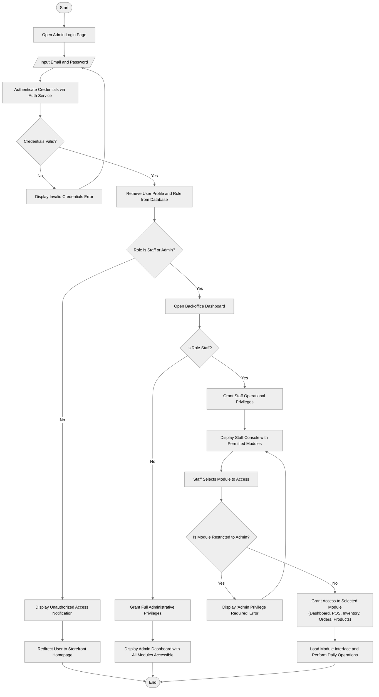
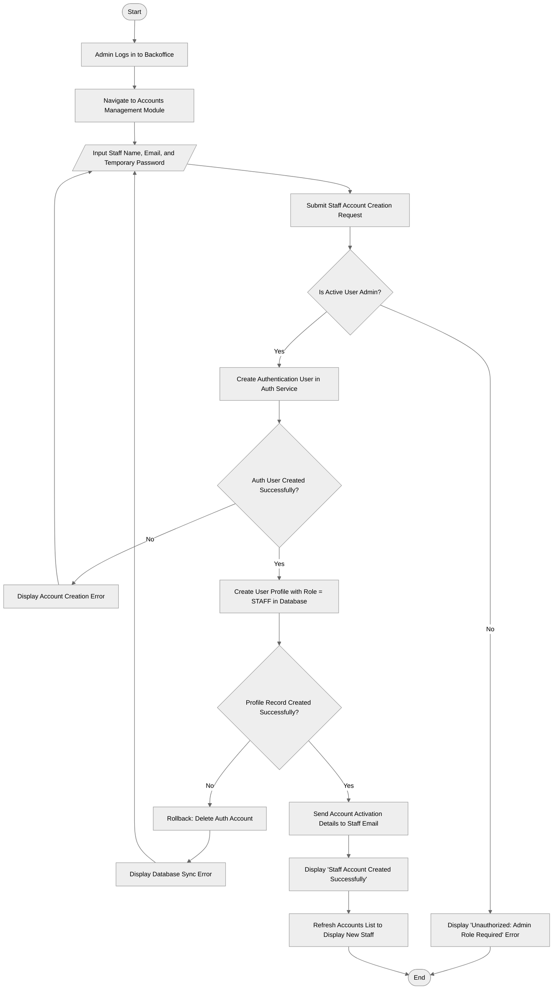

# Staff Account & Role-Based Access Control Flowcharts

This document provides the standard-compliant flowcharts for **Staff Account Creation** and **Admin/Staff Login and Access Control**, adhering strictly to the **Yes/No binary decision diamond standard**.

---

## 1. Figure 4: Admin and Staff Authentication and Role-Based Access Control Flowchart

---

## 2. Supplementary: Staff Account Creation Flowchart

